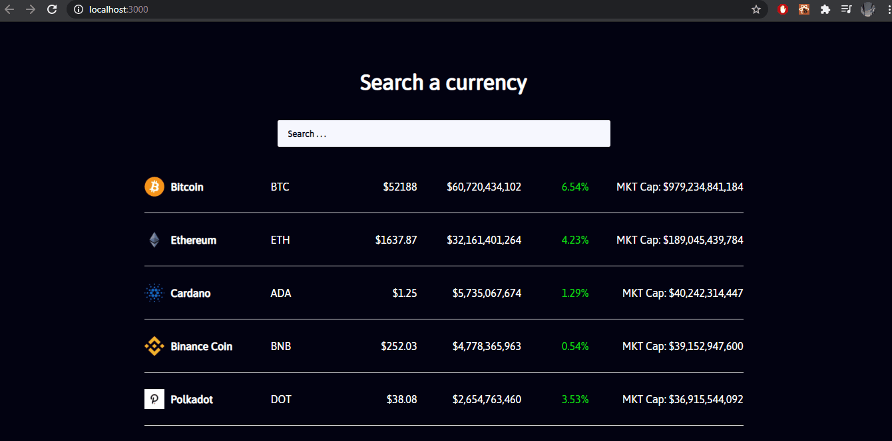

# Cryptocurrency Finance Price Tracker App
I use React Hook in this React JS project. I mainly use useEffect and useState. 
You can search for currencies and have them displayed on the browser. Also, the prices will update live whenever you refresh the page. I get all of the data from a public API.  

[The API Link](https://www.coingecko.com/en/api).

## Demo

